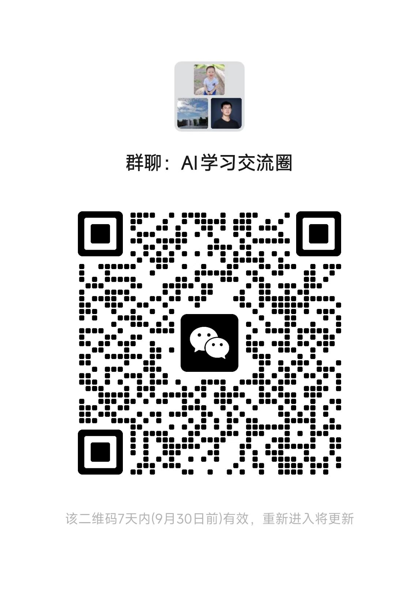

# 小红书采集助手（Chrome 扩展 + 本地服务）

一个把小红书图文笔记采集到**自己机器**上的工具：Chrome 扩展负责在页面上读取内容，随附的本地服务负责保存、查看和导出。没有云端，不注册账号，数据不出本机。

## 功能

- **单篇采集**：打开一篇图文笔记，点一下插件，保存正文、已加载的配图，可勾选附带已加载的评论快照。
- **主题搜索**：在插件独立搜索页关注主题，按页面显示的点赞数排出本次搜索的高赞前十，勾选后批量入库。
- **本地知识库**：服务首页（`http://127.0.0.1:8788`）提供配对码和笔记列表，可查看、删除采集记录。
- **Markdown 文件夹镜像**：每篇笔记同时落一份 `note.md + images/` 到指定文件夹（Obsidian 等工具可直接读），重复采集按最新记录重建，手动改过的标题等字段不会被覆盖。
- **重复去重**：同一篇笔记再次采集自动合并，保留你手动编辑过的字段，更新前先备份旧记录。

## 快速开始

需要 Node.js 18+ 和 Chrome。

```bash
npm install
npm start        # 启动本地服务，默认 http://127.0.0.1:8788
```

1. 打开服务首页 `http://127.0.0.1:8788`，复制页面上的**本机配对码**。
2. 打开 `chrome://extensions` → 开启「开发者模式」→「加载已解压的扩展程序」→ 选择本仓库的 `extension/` 目录。
3. 打开插件设置页（弹窗右上角齿轮，或扩展详情里的「扩展程序选项」），确认服务地址、粘贴配对码。
4. 打开一篇小红书图文笔记，点击插件图标 → 「采集」。

## 配置

全部通过环境变量，无需配置文件：

| 变量 | 默认 | 说明 |
| --- | --- | --- |
| `PORT` | `8788` | 本地服务端口。换端口后，插件设置页里的服务地址要同步修改。 |
| `DATA_DIR` | 仓库内 `data/` | 笔记、图片、密钥的存放目录。该目录不应提交或分享。 |
| `COLLECTOR_SYNC_DIR` | `<DATA_DIR>/exports/collector` | Markdown 镜像目标文件夹。相对路径按 `DATA_DIR` 解析；设为空字符串关闭镜像。 |

示例：`PORT=9000 COLLECTOR_SYNC_DIR=~/Notes/xhs npm start`

## 隐私与安全设计

- 不读取、不上传浏览器 Cookie；只在**你点击采集时**读取当前打开的页面内容。
- 图片只从小红书官方 CDN（`xhscdn.com` / `rednotecdn.com`）下载，单图 5MB、总量 24MB 上限。
- 本地服务只绑定 `127.0.0.1`，接口校验同源与本机来源；采集请求需要 64 位配对码（Bearer），配对码只能从服务首页由你本人复制，扩展自身无法读取。
- 笔记与密钥文件以 0600 权限原子写入，更新前自动备份旧记录。

## 开发与测试

```bash
npm test          # node --test tests/*.test.js
```

扩展源码在 `extension/`（MV3，无构建步骤，改完在扩展管理页点「重新加载」）；服务在 `server/`；首页在 `public/`。

## 已知限制

- 视频笔记不下载、不转写，只能跳回原文。
- 评论只保存「当时页面已加载」的部分，不是完整评论区。
- 点赞等数字是页面显示值（如「1.2万」），非精确数。

## 交流

<table>
  <tr>
    <td align="center" width="50%">
      <br>
      <sub>加我微信 · Zack</sub>
    </td>
    <td align="center" width="50%">
      <br>
      <sub>AI 学习交流圈</sub>
    </td>
  </tr>
</table>

## English

A Chrome extension (MV3) plus a tiny local Node/Express service that saves Xiaohongshu (rednote) image-and-text posts to your own machine: notes are stored as local JSON with images, viewable on the service homepage, and optionally mirrored to a plain Markdown folder (`note.md` + `images/`) for tools like Obsidian. No cloud, no account, no background collection — capture happens only when you click. UI is in Chinese. MIT licensed.

> ⚠️ 请只采集公开内容，遵守平台条款并尊重原作者权益；导出的内容仅供个人学习与备份，勿用于二次分发。

## License

[MIT](LICENSE)
